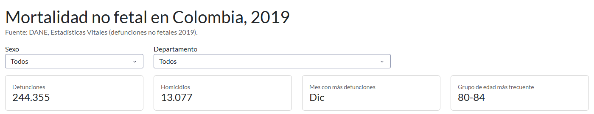
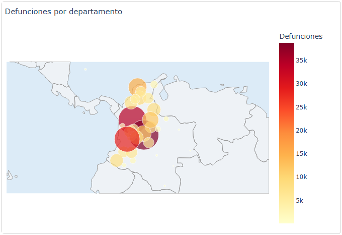
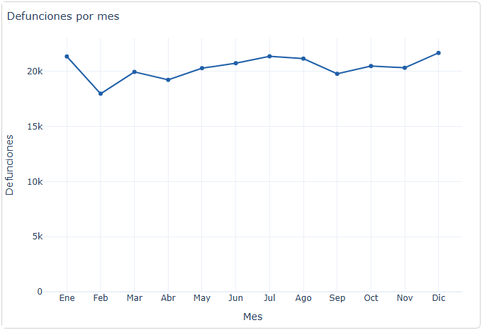
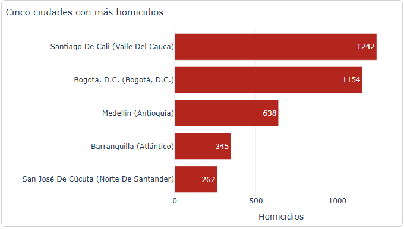
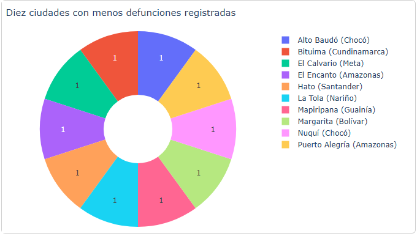
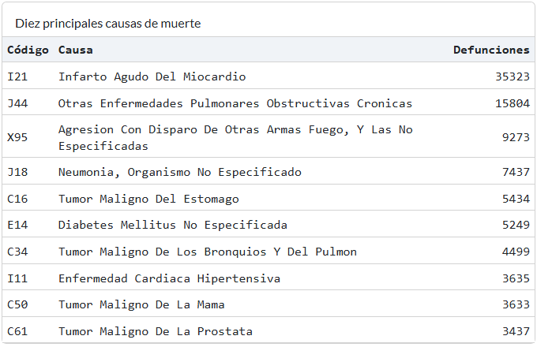
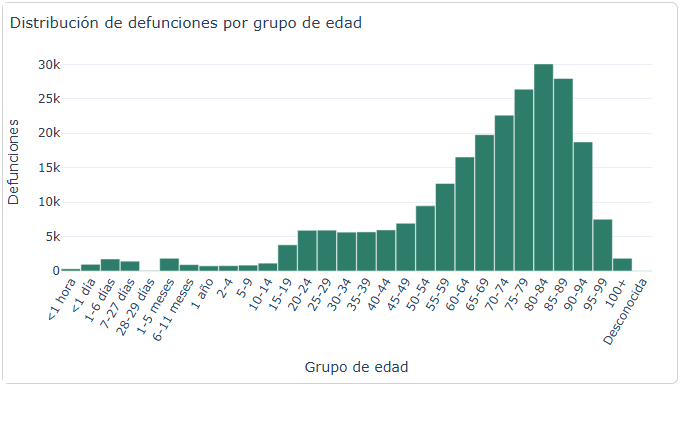
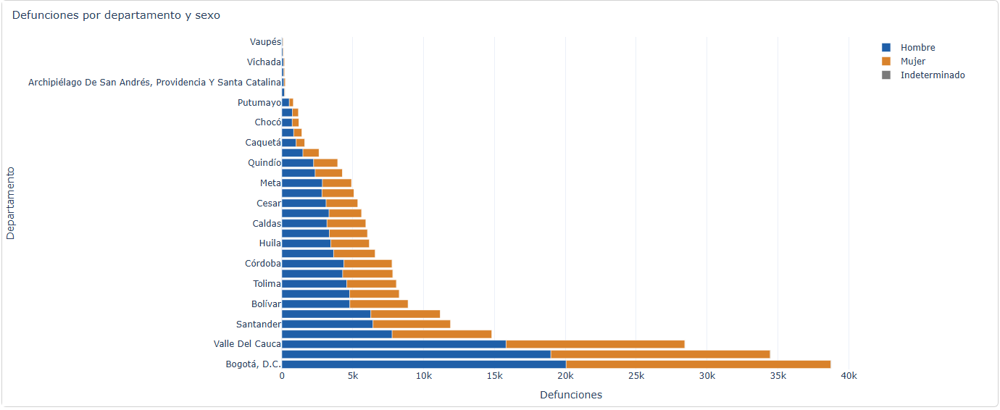

# Aplicación web para el análisis de la mortalidad en Colombia (2019)

Actividad 4 de Aplicaciones I, Maestría en Inteligencia Artificial, Universidad de La Salle.

**Integrantes:** Harold Andrés Cortés López (grupo de una persona)
**Aplicación desplegada:** https://mortalidad-colombia-2019-x4ue.onrender.com
**Repositorio:** https://github.com/haroldanco/mortalidad-colombia-2019

## 1. Introducción y objetivo

La aplicación permite explorar las defunciones no fetales registradas en Colombia en 2019 (244.355 registros del DANE).
El objetivo es ofrecer un tablero interactivo, hecho con Python, Plotly y Dash, que responda dónde, cuándo, a quién y por qué
se concentran las muertes, y que se pueda consultar desde un navegador sin instalar nada.

## 2. Datos

Fuente: DANE, Estadísticas Vitales 2019 (https://microdatos.dane.gov.co/index.php/catalog/696).

| Archivo original | Uso |
|---|---|
| Anexo1.NoFetal2019_CE_15-03-23.xlsx | Registros de defunción (sexo, edad, mes, municipio, manera y causa de muerte) |
| Anexo2.CodigosDeMuerte_CE_15-03-23.xlsx | Descripción de los códigos CIE-10 de tres caracteres |
| Divipola_CE_.xlsx | Nombres de departamentos y municipios y su ubicación (longitud y latitud) |

Para que el despliegue sea rápido, `preparar_datos.py` agrupa los 244.355 registros en tablas pequeñas dentro de `data/`.
La agrupación conserva el total (244.355) y no pierde ninguna dimensión usada por la aplicación.

## 3. Estructura del proyecto

```
app.py               aplicación Dash (diseño y callbacks); expone `server` para gunicorn
preparar_datos.py    convierte los xlsx del DANE en data/*.csv
data/                defunciones.csv.gz, municipios.csv, causas.csv
capturas/            imágenes de la aplicación desplegada usadas en este README
requirements.txt     dependencias con versión
render.yaml          configuración de despliegue en Render
.python-version      versión de Python para el despliegue
```

## 4. Requisitos

Python 3.12 o superior y las bibliotecas de `requirements.txt` (Dash, Dash Bootstrap Components, Plotly, pandas, gunicorn).

## 5. Instalación y ejecución local

```
python -m venv .venv
.venv\Scripts\activate        (Windows)   |   source .venv/bin/activate   (Linux/Mac)
pip install -r requirements.txt
python app.py
```
Abrir http://127.0.0.1:8050 en el navegador. Solo si se quieren regenerar las tablas, descargar los tres xlsx del DANE y ejecutar
`python preparar_datos.py <carpeta_con_los_xlsx>`.

## 6. Despliegue en Render (plataforma como servicio)

1. Subir esta carpeta a un repositorio de GitHub.
2. En https://render.com crear un **Web Service** y elegir el repositorio.
3. Build command: `pip install -r requirements.txt`. Start command: `gunicorn app:server`. Plan: Free.
4. Al terminar el despliegue Render entrega la URL pública de la aplicación.

El plan gratuito suspende la aplicación tras un tiempo sin uso; la primera visita puede tardar cerca de un minuto en despertarla.

## 7. Visualizaciones

Dos filtros (sexo y departamento) actualizan los indicadores y los gráficos. Las dos excepciones están señaladas.

| # | Visualización | Qué muestra |
|---|---|---|
| 1 | Mapa de burbujas | Defunciones por departamento (respeta el filtro de sexo y siempre muestra todo el país) |
| 2 | Gráfico de líneas | Defunciones por mes |
| 3 | Barras horizontales | Las cinco ciudades con más homicidios |
| 4 | Gráfico circular | Las diez ciudades con menos defunciones registradas |
| 5 | Tabla | Diez principales causas de muerte (código CIE-10 y descripción) |
| 6 | Histograma | Defunciones por grupo de edad (30 grupos quinquenales y de la primera infancia del DANE) |
| 7 | Barras apiladas | Defunciones por departamento, separadas por sexo (muestra todo el país) |

### Capturas e interpretación (aplicación desplegada, filtros en "Todos")


Indicadores del año: 244.355 defunciones, 13.077 homicidios, diciembre como el mes con más muertes y 80-84 años como el grupo de edad más frecuente.


Bogotá D.C. (38.760; 15,9 %), Antioquia (34.473; 14,1 %) y Valle del Cauca (28.443; 11,6 %) concentran las defunciones; con Atlántico suman 47,7 %. Es un reflejo de dónde vive más gente, no un mayor riesgo.


Las muertes son estables durante el año. Diciembre (21.678), julio (21.372) y enero (21.354) son los meses más altos y febrero el más bajo (17.974), también por día (642 frente a 699 en diciembre).


Cali (1.242), Bogotá (1.154) y Medellín (638) encabezan los homicidios y suman 3.034 casos (cerca de una cuarta parte del país). El 91,3 % de las víctimas son hombres. Son conteos; para comparar ciudades haría falta la población.


Las diez ciudades con menos defunciones registraron una cada una, por eso el gráfico queda en empate. Hay 13 municipios con una sola defunción y 177 con diez o menos.


Primera causa: infarto agudo del miocardio (35.323), seguida por enfermedades pulmonares obstructivas crónicas (15.804) y agresiones con arma de fuego (9.273). Predominan las enfermedades crónicas.


El pico está en 80-84 años (30.071); 63,4 % de las defunciones son de personas de 65 años o más y 3,0 % de menores de un año.


Los hombres son 55,1 % de las defunciones y las mujeres 44,9 %. La proporción de hombres va de 51,7 % en Bogotá a 76,8 % en Guaviare.

### Limitaciones
- El mapa usa burbujas ubicadas en el centro de cada departamento, calculado con las coordenadas de sus municipios; no dibuja los límites.
- Los datos no incluyen población, así que "menos defunciones" no es lo mismo que "menor tasa de mortalidad". Muchos municipios pequeños tienen una sola defunción, por lo que el gráfico circular muestra un empate.
- Los resultados son conteos del archivo de 2019 y no deben leerse como tasas.
